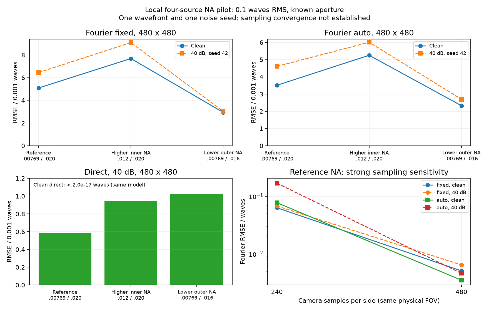

# NA 通光角范围：本地初步结果

日期：2026-10-26。全部计算在本地完成，没有启动远端任务。

本次比较的是环形光瞳内外边界 `NA_in/NA_out`，物面、光栅和相机的安装倾角均为 0°。
参考点对应约 0.4406°–1.1460° 的物方通光极角。这里的角度按真空中的 `angle=asin(NA)` 换算。

## 目前能看出什么

在加密后的三个小场景中，40 dB 噪声下直接法的波前 RMSE 为 `5.85e-4–1.02e-3 waves`，
低于同图上的傅里叶 fixed（`3.04e-3–9.09e-3`）和 auto（`2.70e-3–6.01e-3`）。
无噪声时直接法恢复到约 `1e-17 waves`；这是生成和反演模型一致的结果，不能解释为仪器精度。

在这一组波前和噪声实现中，增大内 NA 后两种方法的含噪误差均高于参考点；
减小外 NA 后傅里叶误差下降，直接法含噪误差却上升。因此尚不支持“通光角越大或越小，两种方法就一定都更准”的说法。
这也不是生产孔径选择规则：只有一组波前、一个噪声 seed，且不同 NA 使用不同物理光瞳和环形基。

另一个更直接的发现是采样敏感性：参考点的傅里叶 fixed 无噪声误差在 240 网格上为 `0.06319 waves`，
加密到 480 网格后为 `0.005091 waves`，相差约 12.4 倍。
所以 240 网格只作为试跑记录；480 网格也只作为初步结果，尚未证明采样收敛，不能给出可靠的普遍 NA 排序。

## 实验范围

使用 BUV0725 三段标量衍射模型，四个源分别传播后叠加强度；保留周期方孔光栅。
这是一个独立的四源小场景，不能视为用四个代表源近似历史 64 源场景。
没有修改直接法或傅里叶法的核心算法。

| 项目 | 240 网格初扫 | 480 网格代表点复核 |
|---|---|---|
| 相机 / 光栅数组 | 240×240 / 480×480 | 480×480 / 960×960 |
| 光源数 | 4 | 4 |
| 相机像元 | 50 μm | 25 μm |
| 光栅采样间隔 | 67 nm | 33.5 nm |
| 相机 / 光栅物理视场 | 12 mm / 32.16 μm | 同左 |
| 物面物理视场 | 13.4 μm | 同左 |
| 物方 NA Nyquist | 0.06 | 0.12 |
| NA 工况数 | 5 | 3 |
| 结果行数 | 30 | 18 |

所有工况使用四个参考模式 `7,25,11,15`，系数方向 `[0.25,0.15,0.05,0.2]`，
在各自的完整物镜环形光瞳上归一化为 `0.1 waves RMS`。
改变内外 NA 后，光瞳及环形基会改变；比较的是同一模式约定、同一系数方向和 RMS 的不同问题，
并非固定物理相位图被不同孔径截取。

每张观测分别交给直接法、傅里叶 fixed、傅里叶 auto：

- 直接法知道正确的 NA；使用 SciPy TRF、解析强度导数、零初值、1500 个固定种子抽样像素，最多 35 次函数评估，联合估计增益和背景。真值不参与初始化。
- 傅里叶 fixed/auto 在每个 NA 和采样条件下各自独立标定：零像差及正负单模式图，幅度 0.02 waves，另有独立混合图检查。比较包含各自标定的作用，不能全部归因于找峰。
- 频谱名义中心为 `(cx+44,cy)` / `(cx,cy+44)`，半宽 20 bin；auto 在附近 ±8 bin 内找峰。未按测试真值调窗。
- Gaussian 噪声在干净图峰值归一化后加入，40 dB 对应标准差 0.01，仅 seed 42。相同条件的三种方法共用同一个观测文件。

主 RMSE 在该 NA 的完整物镜光瞳内去除活塞、双向倾斜和离焦。不同方法评价域相同；不同 NA 的评价域不同。
保留倾斜和离焦的误差、系数误差、PV、`RMSE / 输入RMS` 均在数据表中保存。
噪声口径控制峰值 SNR，不控制光子预算，因此没有计入通光量变化带来的真实光子噪声代价。

## 加密网格的三个代表点

所有误差单位均为 waves。每个工况只有一份含噪观测，没有统计置信区间。

| 工况 | NA 内界 / 外界 | 极角范围 / ° | 遮拦比 | 评价像素 |
|---|---|---|---:|---:|
| 参考点 | 0.00769 / 0.020 | 0.4406–1.1460 | 0.3845 | 4276 |
| 固定外 NA，增大内 NA | 0.012 / 0.020 | 0.6876–1.1460 | 0.6000 | 3236 |
| 固定内 NA，减小外 NA | 0.00769 / 0.016 | 0.4406–0.9168 | 0.4806 | 2460 |

| 工况 | FT fixed 无噪声 | FT auto 无噪声 | FT fixed 40 dB | FT auto 40 dB | 直接法 40 dB |
|---|---:|---:|---:|---:|---:|
| 参考点 | 0.005091 | 0.003512 | 0.006454 | 0.004610 | 0.0005849 |
| 增大内 NA | 0.007682 | 0.005254 | 0.009086 | 0.006009 | 0.0009489 |
| 减小外 NA | 0.002942 | 0.002327 | 0.003039 | 0.002697 | 0.001023 |

无噪声直接法分别为 `1.0411e-17`、`1.9923e-17`、`1.5125e-17 waves`。
六次直接拟合均在 6–7 次函数评估内满足优化停止条件。
FT 标定响应条件数为 1.68–2.14；这说明本次误差不能简单归咎于响应矩阵严重病态，但也不能证明标定在任意像差下都有效。



图中的连线仅连接离散工况；不是连续 NA 拟合曲线。直接法无噪声的数值零不放进含噪柱图。

## 粗采样记录与解读边界

以下 240 网格数据完整保留，供检查和复现，不用于选择 NA。

| NA 内界 / 外界 | FT fixed 无噪声 | FT auto 无噪声 | FT fixed 40 dB | FT auto 40 dB | 直接法 40 dB |
|---|---:|---:|---:|---:|---:|
| 0.00769 / 0.020 | 0.06319 | 0.07736 | 0.06768 | 0.16851 | 0.001022 |
| 0.004 / 0.020 | 0.07122 | 0.20951 | 0.06209 | 0.03511 | 0.0006838 |
| 0.012 / 0.020 | 0.29293 | 0.20913 | 0.23757 | 0.13742 | 0.0008767 |
| 0.00769 / 0.016 | 0.11355 | 0.04512 | 0.11308 | 0.05225 | 0.001152 |
| 0.006152 / 0.016 | 0.08192 | 0.06578 | 0.10145 | 0.22372 | 0.001021 |

粗网格中，一次加噪后 FT 误差反而降低的情况也存在；不能将其解释为噪声改善恢复能力。
auto 选择的是局部频谱峰值，不保证对应所需边带的物理中心。

加密时保持物面、光栅、相机视场和光源位置不变，同时改变了传播离散化、相机采样、整数剪切与平滑像素宽度，
并重新做了标定。它反映整个流程的采样敏感性，没有隔离出误差来自哪一步。
由于物面物理视场不变，光瞳频率网格间距也不变，同一 NA 的评价像素数在两档网格下保持一致。
两档结果差异很大，尚不能把 480 网格称作数值收敛结果，也不能用它替代历史原采样精度数字。

## 数据核对、资源与复现

三个任务串行执行，源 batch=1、worker=1，均已结束，无残留计算进程。

| 本地任务 | 行数 | 实际计算墙钟 / s | 峰值 RSS / MiB |
|---|---:|---:|---:|
| 240 网格，5 组 NA | 30 | 7.90 | 362.6 |
| 480 网格，参考 NA | 6 | 6.82 | 719.1 |
| 480 网格，另两个边界工况 | 12 | 11.27 | 616.6 |

计算任务墙钟合计约 **26.0 秒**，不含准备、数据核对、绘图和报告；最高 RSS 约 **0.70 GiB**。
全部 48 行成功输出，16 次直接拟合均满足停止条件；`status=ok` 和 `converged` 不替代误差判断。

逐行检查了 48 个唯一工况键、16 份三方法共享的观测、实际输入 RMS、光瞳像素数，
并从保存的原始图和 seed 精确复现噪声；用保存的系数和环形基独立重算了所有主 RMSE。
完整未舍入的结果及源文件 SHA256 见：

- [48 行 JSON](local-preliminary/results.json) / [CSV](local-preliminary/results.csv)
- [来源、配置、资源与核对记录](local-preliminary/provenance.json)
- [全流程协议](../../aperture-study.md)

本地原始观测、标定与轨迹在 `output/apertures_local_20261026/`、
`output/apertures_local_refinement_20261026/`、`output/apertures_local_boundaries_20261026/`，未加入 Git。
加密参考点只计算了一次，后两个点从另一新目录补算，汇总表逐行保留来源，没有覆盖或伪装成同一次运行。

从仓库根目录可用新输出目录复现两档设计：

```bash
uv run python -m lsi apertures --config configs/apertures-local.json \
  --allow-large-run --output output/new-local-coarse
uv run python -m lsi apertures --config configs/apertures-local-refined.json \
  --allow-large-run --output output/new-local-refined
uv run --group report python -m tools.plot_apertures
```

最后一条命令只读已提交的表格重新绘图，不运行传播或拟合。
本次没有运行 64 源原采样 NA 扫描、更多波前或更多噪声 seed，也没有求最优 NA。
现有结果支持在这些小场景中比较两种解算流程；普遍孔径规律仍需收敛后的采样和更多独立样本。
