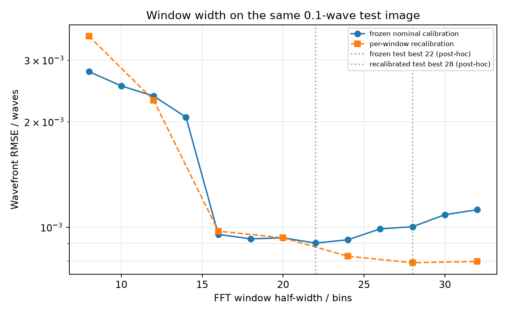
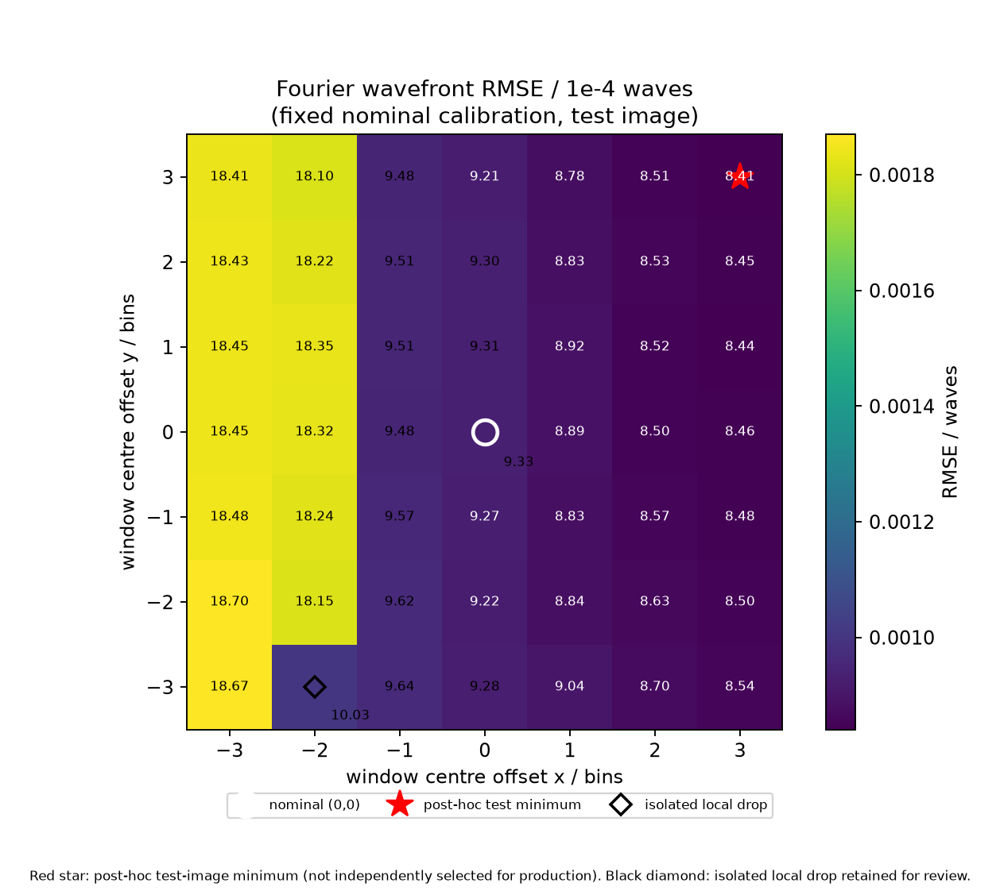
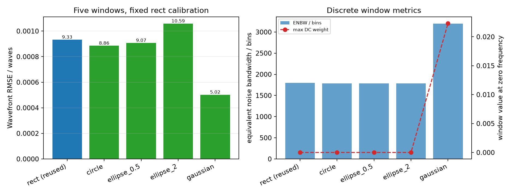
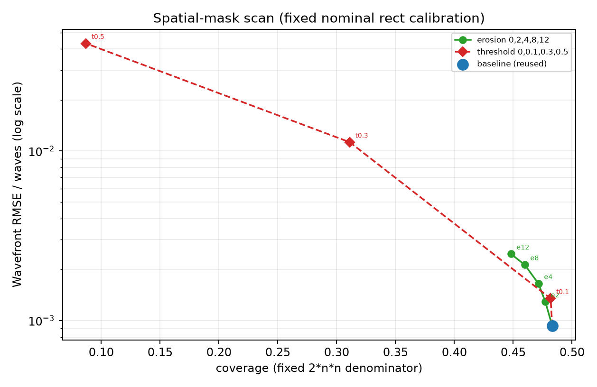
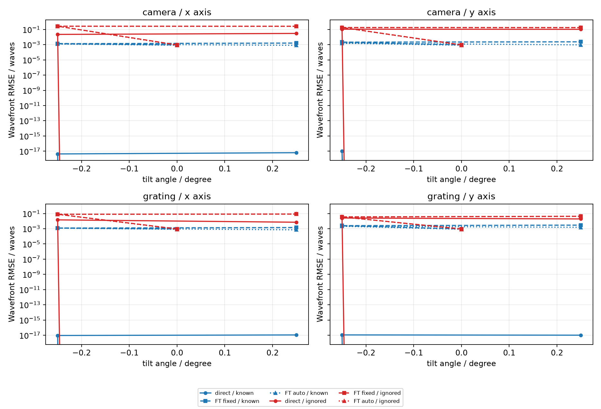
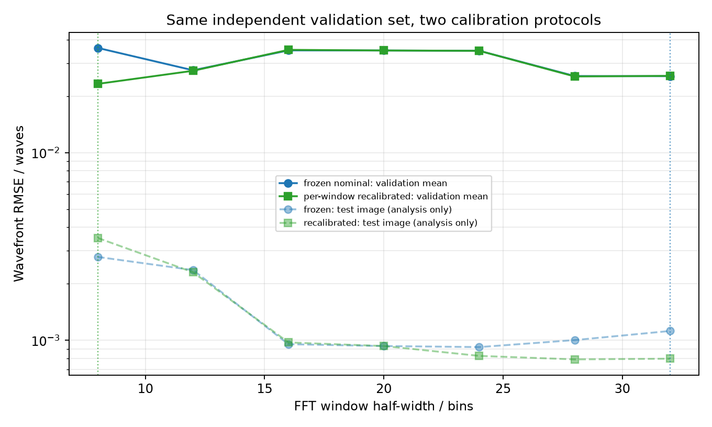

# 参考衍射模型下的三目标后续研究报告

> 目标更正（2026-10-26）：用户确认第三项“不同角度”指 `NA_in/NA_out` 所限定的通光角范围。
> 本报告第 4 节研究的是部件安装倾角，只保留为附加结果，不能作为第三目标已经完成的依据。
> NA 已完成少量本地四源实验，见[初步结果](../apertures/local-preliminary-report.md)；完整原采样 NA 扫描尚未运行。
> 设计见[通光角范围研究协议](../../aperture-study.md)。本报告原有实验数字保持不变。
>
> 范围：基于 BUV0725/Retrieval0806 参考标量衍射模型的仿真反演，结果不代表仪器实测精度。
> 数据：相机原采样为 1200×1200，光栅为 2400×2400；64 个源分别传播后再叠加强度。
> 光栅采用 Square 周期方孔阵列，边长占空比为 50%（开口面积为 25%）。
> 统一评价使用固定的物镜环形光瞳。主 RMSE 去除了 piston、双向倾斜和离焦，同时保留完整误差与全部系数误差。
> 物理真值只用于评价和独立标定，不用于初始化或生产参数选择。

## 摘要

1. **傅里叶与直接最小二乘**：在零角度、四模式、0.1 waves、无噪声且生成与反演使用同一模型的基准中，标定傅里叶 RMSE 为
   `9.3268e-4` waves，直接法为 `4.2401e-18` waves（单一零初值）。这组结果不能代表一般恢复率或仪器精度。
   在 0.2/0.4 waves 的混合波前中，傅里叶的局部线性标定明显退化；直接法在这些同模型算例中仍能恢复。
   0.2 waves 的 5 个初值都收敛到数值零，但这只覆盖一个方向和一个算例。
2. **频谱窗与空间有效区**：对 0.1 waves 测试图，冻结标定的窗宽曲线在 22 bin 附近最低（`9.0086e-4`），
   32 bin 时升至 `1.1220e-3`；逐窗重标定在 28 bin 最低（`7.9179e-4`），32 bin 为 `7.9851e-4`。
   这些数值只说明本次测试图和已测窗口中的低点或平台，不能外推为普遍最优值。
   7×7 中心网格的最低点为 `(3,3)`，`8.4063e-4` waves，但它位于 ±3 网格角点，也不能外推。
   本次测试中，空间掩膜腐蚀和幅值剔除都降低了 coverage、增大了 RMSE，没有看到 coverage 降低后波前误差改善的区间。
3. **部件倾角附加研究**：这部分没有扫描用户要求的通光角范围。使用正确几何时，direct 从零初值恢复到数值零，分别重标定的 FT auto 流程误差低于 fixed。
   忽略几何时，direct 在有限优化预算内留下非零误差，FT 误差达到百分之几至十分之几 waves。
   参考代码中的倾斜是输入场相位坡度近似，不是严格的旋转平面传播；物面单像素源倾斜只作为零效应对照。
4. **选窗策略**：冻结标定和逐窗重标定采用不同协议，结果需要分开解读。用同一组 3 个独立混合样本
   （0.05/0.1/0.2 waves）重新选择时，冻结协议选中 32，重标定协议选中 8；测试图的事后最优则为 24/28。
   验证集较小，验证均值又由 0.2 waves 的非线性误差主导，选择结果不稳定，不能直接作为生产规则。

---

## 1. 数据、模型与评价

- 物理模型：采用 BUV0725 的三段标量传播、环形光瞳 4f、Square 光栅透射函数和 Fresnel/CZT 传播。
  每个源独立传播后再叠加强度，共 64 个源；计算中未用五束或代表源替代。
- 解算约定：沿用 Retrieval0806 的边带提取、移频、解包裹、平滑和差分基拟合。
  `reference` 与 `retrieval` 的轴向偏移和 error_mode 差异分别保留，没有混用。
- 未知量：默认零基模式 `7,25,11,15`，即 `(3,1),(5,-5),(5,-1),(3,3)`。
- 评价：使用固定环形光瞳，`evaluation_pixels=26772`。主 RMSE 去除 piston、双向倾斜和离焦，
  同时报告保留倾斜/离焦的误差；整体变号不计为正确恢复。
- 单位：物镜光瞳上的 waves。原版傅里叶输出为 a.u.；标定版额外使用零像差和单项像差的独立训练图，
  因此需要单独说明这部分数据成本及其局部线性范围。

---

## 2. 目标一：傅里叶与直接最小二乘

### 2.1 0.1 waves 四模式基准

条件：零角度、0.1 waves RMS、无噪声，生成和反演使用同一模型。

| 方法 | RMSE / waves | 说明 |
|---|---:|---|
| 标定傅里叶 | `9.3268e-4` | 独立标定；response 条件数约 1.9729 |
| 直接最小二乘 | `4.2401e-18` | 单一零初值，达到数值精度 |
| 原版傅里叶 | 不做 waves 换算 | 保留 a.u. 输出 |

这组结果只说明同模型、无噪声、单初值算例能够成功，不能外推一般恢复率、噪声鲁棒性或仪器精度。

### 2.2 代表性混合 RMS

采用同一零角度、无噪声模型，测试两个独立的随机混合方向。FT 使用冻结的零角度 rect 标定，
direct 使用零初值和一个独立随机初值。

| 设置 | FT RMSE / waves | direct RMSE / waves |
|---|---:|---:|
| 0.05 dir0 | `3.1376e-4` | `5.2036e-18` |
| 0.05 dir1 | `1.6708e-4` | `1.4558e-17` |
| 0.2 dir0 | `1.2468e-2` | `0` |
| 0.2 dir1 | `3.6358e-3` | `0` |
| 0.4 dir0 | `6.6172e-2` | `1.7910e-15` |
| 0.4 dir1 | `2.1542e-2` | `0` |

傅里叶误差随幅度明显非线性增长，与局部线性标定的适用范围有限相符。direct 在这些同模型算例中仍能恢复，
但极小误差只说明这些算例成功，不能代表任意初值、噪声条件或真实系统都能成功。

### 2.3 40 dB 噪声

FT 与 direct 使用同一干净观测和同一份噪声实现。噪声定义为 `20 log10(peak / sd)`，峰值归一化为 1。

| seed | FT RMSE / waves | direct RMSE / waves | direct nfev |
|---:|---:|---:|---:|
| 42 | `1.0291e-3` | `5.1169e-4` | 6 |
| 43 | `1.0337e-3` | `2.4072e-4` | 6 |
| 44 | `9.6007e-4` | `4.2622e-4` | 6 |

三个 seed 中 direct 都优于固定标定 FT。但样本只有 3 个，不能据此估计一般恢复率。

### 2.4 直接法初始化稳定性

在 0.2 waves、dir0 条件下得到 5 个结果：一个零初值和 4 个按观测强度残差筛选的候选，筛选过程不使用真值。
5 个 trial 都收敛，RMSE 都达到数值零，nfev 均约为 7。这不能保证其他方向或更大像差也能成功。
筛选规则只使用观测残差，没有使用测试真值。

---

## 3. 目标二：频谱窗与空间有效区

### 3.1 窗宽

固定中心 0、rect 窗、整数移频，以及相同的平滑、掩膜和拟合参数。冻结标定使用半宽 20、中心 0 训练的
名义响应；逐窗重标定则为每个窗分别使用独立训练图，作为单独诊断。

| 半宽 / bin | 冻结标定 RMSE / waves | 逐窗重标定 RMSE / waves |
|---:|---:|---:|
| 8 | `2.7827e-3` | `3.5123e-3` |
| 12 | `2.3687e-3` | `2.3052e-3` |
| 16 | `9.5385e-4` | `9.7461e-4` |
| 20 | `9.3268e-4` | `9.3268e-4` |
| 24 | `9.2073e-4` | `8.2660e-4` |
| 28 | `1.0033e-3` | `7.9179e-4` |
| 32 | `1.1220e-3` | `7.9851e-4` |

冻结标定在 22 bin 达到事后最低值 `9.0086e-4`（22 不在上面的共同 7 点表中）；逐窗重标定在 28 bin
最低。两条曲线只反映本次测试图和已测窗口中的低点或平台，不能外推为普遍最优。
冻结与重标定必须分开比较，因为重标定需要额外的独立训练数据。

### 3.2 7×7 二维中心

固定半宽 20 和冻结名义标定，扫描 49 个整数偏移。名义点 `(0,0)` 为 `9.3268e-4`。
事后最低点 `(3,3)` 为 `8.4063e-4`，位于 ±3 角点；最大值 `(-3,-2)` 为 `1.8696e-3`。
coverage 恒为 `0.483143`，phase residual `0.05901–0.06571`，PV `0.00691–0.01438` waves。

`(-2,-3)` 出现孤立低值 `1.0027e-3`，比邻点中位数低约 `8.13e-4`。精确复算（RMSE、phase residual、
coverage、系数和中心的差值都为零）确认该结果可以稳定复现，但 wrapped/unwrapped 相位差很小，原因仍未解释。
`status=ok` 只表示结果已保存，不代表物理结果正确或 unwrap 分支可靠；该点继续标记为异常，不用于平滑趋势或生产中心。

### 3.3 窗形状/长宽比

五个设置共用同一套冻结 rect 名义标定；circle/ellipse 保持等连续面积，gaussian 保持等积分权重。
`weight_sum`、ENBW 和 DC 权重均为实际离散指标。

| 设置 | RMSE / waves | PV / waves | weight_sum | ENBW | max DC 点权重 |
|---|---:|---:|---:|---:|---:|
| rect（复用） | `9.3268e-4` | `7.5732e-3` | 1600 | 1794.78 | 0 |
| circle | `8.8572e-4` | `7.2056e-3` | 1605 | 1782.07 | 0 |
| ellipse 0.5 | `9.0742e-4` | `6.4081e-3` | 1589 | 1782.99 | 0 |
| ellipse 2 | `1.0588e-3` | `8.7589e-3` | 1589 | 1782.99 | 0 |
| gaussian | `5.0238e-4` | `4.3789e-3` | 1600 | 3200 | `0.02234` |

gaussian 的 RMSE 最低，但 ENBW 约为 rect 的 1.78 倍，DC 点窗口权重为 `0.02234`
（这里的数值是窗口在 DC 频点的权重，不是总零频泄漏能量）。不同形状的“半宽 20”并不对应同一截止频率；
形状、面积、权重、支撑、DC 点值和固定 rect 标定的适配共同影响结果，不能把差异单独归因于形状更优。

### 3.4 空间有效区

固定 rect、半宽 20、名义标定和中心 0。8 个设置逐项扫描单一变量，没有做交叉组合。
评价光瞳始终包含 26772 个像素。

| 设置 | RMSE / waves | PV / waves | coverage | 有效像素总数 | phase residual |
|---|---:|---:|---:|---:|---:|
| baseline | `9.3268e-4` | `7.5732e-3` | `0.483143` | 1,391,452 | `0.05924` |
| erosion 2 | `1.2909e-3` | `1.1511e-2` | `0.477299` | 1,374,620 | `0.05630` |
| erosion 4 | `1.6518e-3` | `1.4896e-2` | `0.471454` | 1,357,788 | `0.05431` |
| erosion 8 | `2.1349e-3` | `1.8712e-2` | `0.459765` | 1,324,124 | `0.05192` |
| erosion 12 | `2.4721e-3` | `2.0548e-2` | `0.448076` | 1,290,460 | `0.05036` |
| threshold 0.1 | `1.3497e-3` | `1.1424e-2` | `0.481793` | 1,387,563 | `0.05819` |
| threshold 0.3 | `1.1277e-2` | `8.8430e-2` | `0.311110` | 895,998 | `0.05053` |
| threshold 0.5 | `4.3137e-2` | `3.3123e-1` | `0.086993` | 250,539 | `0.05074` |

随着 coverage 下降，RMSE 上升；腐蚀越强时 phase residual 反而下降，但波前 RMSE 上升，因此不能把残差下降理解为波前改善。
阈值 0.3 和 0.5 的退化尤其明显。本次没有看到覆盖率下降后误差反而改善的区间。
这些结果来自单张测试图和固定标定，只能用于敏感性分析，不能据此确定生产阈值。

---

## 4. 目标三：部件/方向倾斜

参考代码通过输入场相位坡度修正来表示倾斜，不是严格的旋转平面传播。物面单像素源的倾斜只改变整体相位，
因此在本模型中是零效应对照，不能据此推断真实扩展光源也没有影响。

### 4.1 camera x +0.25° 试点

对同一张倾斜观测，known 使用倾斜模型和对应的独立 fixed/auto 标定；ignored 使用零角度模型和
零角度 fixed/auto 标定；direct 均从零初值开始。

fixed 与 auto 分别重新训练响应矩阵。因此这里比较的是“中心检测方式及其配套重标定”的完整流程，
没有执行共享同一标定响应、只改变中心检测方式的消融实验，不能把误差差异全部归因于中心选择本身。
在几何参数已知的条件下，独立标定还使用了对应几何的训练数据。

| 条件 | RMSE / waves |
|---|---:|
| zero direct | `0` |
| zero FT fixed / auto | `9.3268e-4` / `8.4397e-4` |
| known direct | `6.3066e-18` |
| known FT fixed / auto | `1.6145e-3` / `8.2288e-4` |
| ignored direct | `2.9821e-2`（60 nfev，未收敛） |
| ignored FT fixed / auto | `2.6332e-1` / `2.6308e-1` |

known direct 恢复到数值零，known FT auto 的配套重标定流程误差低于 fixed。
ignored direct 达到评估上限时仍有较大误差，因此不能把这个有限预算结果当作已经找到局部或全局最优。

### 4.2 camera/grating × x/y × ±0.25°

共测试 8 个非零几何。每个几何包含 6 行（known/ignored × direct/fixed/auto），共 48 行，均成功写出结果，程序没有异常。
这不表示 48 行都恢复正确，部分 direct 并未收敛。known direct 均为 `~1e-17` 或 0；
known FT auto 的配套重标定流程误差均低于 fixed，范围约为 `7.13e-4–2.12e-3`。
ignored direct 约为 `7.10e-3–1.071e-1`，ignored FT 约为 `3.55e-2–2.66e-1`。
不同部件、轴向和角度符号的失配误差明显不对称。ignored direct 在有限预算下仍有非零误差，
因此不能据此确认它已经达到局部或全局最优；优化器停止也不等于恢复成功。

### 4.3 camera x ±0.5° 代表扩展

> 本节由 `angles_batch_camera_x_pm05` 生成，只测试 camera x 轴 ±0.5°，没有对其他部件和方向做 ±0.5° 穷举。

| 条件 | -0.5° RMSE / waves | +0.5° RMSE / waves |
|---|---:|---:|
| known direct | `1.0882e-17` | `1.0336e-17` |
| known FT fixed | `1.4461e-3` | `1.4885e-3` |
| known FT auto | `1.2619e-3` | `1.3331e-3` |
| ignored direct | `4.1973e-2`（未收敛） | `4.6386e-2`（converged=True 但非零） |
| ignored FT fixed | `5.3383e-1` | `5.3276e-1` |
| ignored FT auto | `5.3361e-1` | `5.3255e-1` |

与 camera x ±0.25° 的同符号结果相比，ignored FT 由约 `0.263–0.266` waves 升至约 `0.533` waves，
约为原来的两倍；ignored direct 约为原来的 1.6–1.9 倍。known auto 的误差增大，但 fixed 正角度误差
从 `1.6145e-3` 降至 `1.4885e-3`，没有呈现单调关系，因此不能概括为所有 known FT 都会随角度增大而恶化。
`+0.5°` 的 ignored direct 虽然 `converged=True`，RMSE 仍为 `4.64e-2`，说明优化器停止标记不能作为物理恢复成功的判据。
这项扩展只覆盖 camera x，不能外推到其他部件或方向。

---

## 5. 选窗策略的可追溯比较

使用同一组 3 个独立混合验证样本（0.05/0.1/0.2 waves）和共同的已测宽度 8–32，
分别评估冻结标定和逐窗重标定。测试真值只在事后比较，不参与选择。

| 宽度 | 冻结验证均值 | 重标定验证均值 | 冻结测试 | 重标定测试 |
|---:|---:|---:|---:|---:|
| 8 | `3.6153e-2` | `2.3246e-2` | `2.7827e-3` | `3.5123e-3` |
| 12 | `2.7469e-2` | `2.7303e-2` | `2.3687e-3` | `2.3052e-3` |
| 16 | `3.5065e-2` | `3.5298e-2` | `9.5385e-4` | `9.7461e-4` |
| 20 | `3.5026e-2` | `3.5026e-2` | `9.3268e-4` | `9.3268e-4` |
| 24 | `3.4893e-2` | `3.4879e-2` | `9.2073e-4` | `8.2660e-4` |
| 28 | `2.5602e-2` | `2.5471e-2` | `1.0033e-3` | `7.9179e-4` |
| 32 | `2.5558e-2` | `2.5646e-2` | `1.1220e-3` | `7.9851e-4` |

验证选中的宽度为：冻结 32，重标定 8；测试图的事后最优为：冻结 24，重标定 28。
验证均值由 0.2 waves 的严重非线性误差主导，选择结果不稳定，不能据此确定生产窗。
差异也不能只归因于验证幅度，波前组合、样本数和标定适配都会影响结果。

---

## 6. 资源、失败与可复核性

主要运行均在 memoh-ws 上以单任务串行方式执行，worker/batch=1；8 GiB Mac 未运行大规模实验。
各阶段峰值内存约为 2.4–3.3 GiB，没有出现 OOM；所有结果都按点或按行即时保存。

`complete`/`status=ok` 只表示运行或数值结果已经保存，不能替代恢复精度判断。
优化器的 `converged`、仿真误差和 `recovered` 需要分别查看；未收敛和未恢复的行也都保留。

| 阶段 | 规模 | 墙钟 | 峰值 RSS | 结果 |
|---|---:|---:|---:|---|
| 窗宽冻结 | 13 窗 | 680 s | 2667 MiB | complete |
| 窗宽重标定 | 7 窗 | 575 s + 补 9 s | 2729 MiB | complete（源中断+补算） |
| 7×7 中心 | 49 点 | 520 s | 2453 MiB | complete；`(-2,-3)` 异常保留 |
| 形状 | 5 设置 | 331 s | 2574 MiB | complete |
| 掩膜 | 8 设置 | 195 s | 2701 MiB | complete |
| 角度 pilot | 9 行 | 637 s | 3261 MiB | complete |
| camera ±0.25 | 18 行 | 1006 s | 3346 MiB | complete |
| grating ±0.25 | 24 行 | 1019 s | 3344 MiB | complete |
| 噪声/初值 | 19 行 | 约 931 s | 约 1.0 GiB | complete；三次脚本修复后 v4 最终 |
| 选窗策略 | 42 次重建 | 约 7–8 min | 约 2.6 GiB | complete |
| camera x ±0.5 | 12 行 | 1006 s | 3300 MiB | complete（代表扩展） |

失败与异常：

- 阶段 1 的 `width_32_fourier.npz` 在中断时写坏，未被复用；补算使用已保存的标定和观测。
- 阶段 2a 首次运行的默认点集漏掉 y=-1…-3，已补算，并在合并 manifest 中记录；原始 10 点目录未修改。
- 阶段 2b 的 `(-2,-3)` 孤立低值可以稳定复现，但原因仍未解释，继续按异常处理。
- 阶段 3 的角度 ignored direct 多次在有限预算内留下非零误差；优化器停止不等于恢复成功。
- 噪声脚本前几版因参数/schema 报错，失败日志均保留；最终 v4 产生 19 行有效结果。

原始观测、标定数组、轨迹和大图保存在远端 `output/diffraction/followup_20261021/`。
Git 只保存小型 JSON/CSV/PNG 摘要和脚本，`work/` 被忽略，大数组不进入仓库。

---

## 7. 限制

- 全部结果来自同一参考模型的仿真反演；生成和反演使用同一物理模型，不能据此给出仪器精度或实测恢复率。
- 测试图基本只有一个 0.1 waves 四模式真值；部分 RMS、噪声和角度只取代表点，不构成全参数统计。
- 傅里叶标定是局部线性标定；0.2/0.4 waves 已明显超出其适用范围，gaussian 等形状仍使用固定 rect 标定。
- 参考倾斜采用相位坡度近似，不是旋转平面传播；物面单像素倾斜只构成零效应控制。
- 7×7 中心扫描只覆盖 ±3 bin 的整数偏移；`(3,3)` 的边界最低值只说明这一有限范围内的结果。
- `(-2,-3)` 的异常原因尚未解释；精确复现只排除了已经检查的存储、汇总和非确定性问题。
- 选窗验证样本只有 3 个，同时改变了幅度和波前组合；冻结与重标定曲线不能混合排名。
- 未测试 35 个未知模式、加密网格或真实数据，因此不能据此宣称泛化能力。
- ±0.5° 只扩展了 camera x，结果不能外推到其他部件或方向。
- 角度 fixed/auto 分别重标定，尚未进行共享响应矩阵的中心方式消融；流程差异不能单独归因于中心检测。

---

## 8. 复现与产物

- 代码：分支 `diffraction-window-tilt-followup`，起点 `b9b2f22`，本地 checkpoint `e76fda3`；
  后续 PR 不自动合并，PR15 也不自动合并。
- 历史阶段结果由一次性远端扫描脚本生成；重构后这些脚本不再作为生产代码保留。
  当前运行入口为 `python -m lsi`，实验配置见 `configs/`；新结构说明见仓库 README。
  原始阶段脚本可按本报告记录的提交 `8628f3c` 从 Git 历史取出，历史报告中的批次目录不会被新运行覆盖。
- 摘要：`docs/results/followup/stage1-*` 到 `stage3c-*`；图：`docs/results/followup/figures/`。
- 后续 PR：[#16](https://github.com/ch1y1z1/chessboard-lsi/pull/16)（base `shear-code-overview`，OPEN，未合并）。
- 本地 checkpoint：`e76fda3`（阶段 1–2d）；研究提交：`2a6a07e`；远端交付末提交：`29be2cc`。
  后续审查修正见 PR #16 的提交记录，实验数值未重新计算。
- 原始数据：`output/diffraction/followup_20261021/`；交接参考与基准：`work/handoff-20261021/`（不提交）。
