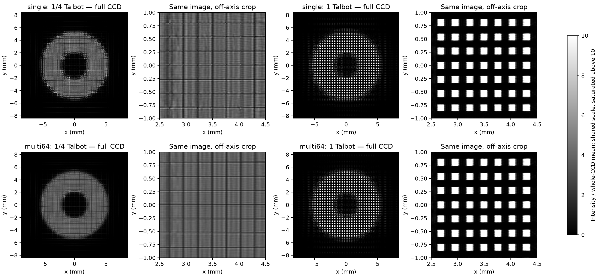
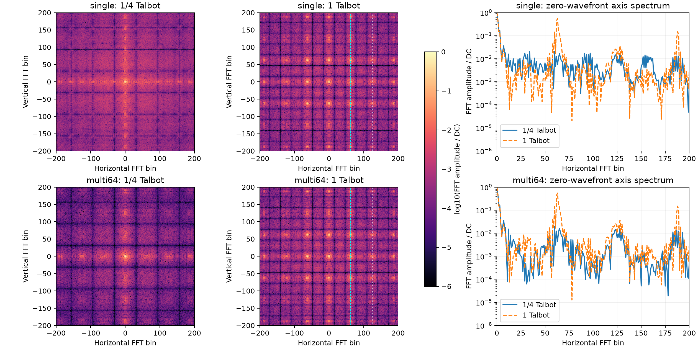
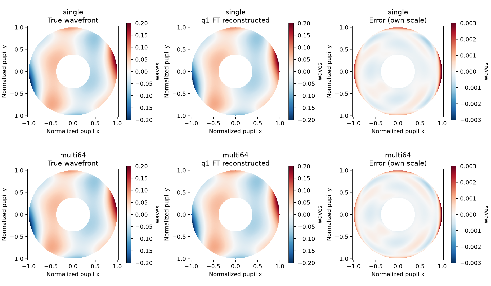

一阶泰伯配置的周期结构更清晰。FT 退化主要来自边带与差分模型选择，以及相位提取流程。

## A 先看结果

同一新配置观测，40 dB 全光瞳误差如下。单位为 waves RMS。

| 光源 | 既有二倍频 OLS | 本轮基频方案 | 改善倍数 |
|---|---:|---:|---:|
| 单源 | 0.011409 | **0.00044352** | 25.7 |
| 64 源 | 0.020614 | **0.00038005** | 54.2 |

基频方案包含相邻级次差分基和独立标定。它同时调整边带、差分几何及有效区。

结果适用于本模型及小像差条件。无噪声仍有误差，不能当作实际仪器精度。

## B 项目与两套参数

研究主线是完整衍射强度的 LM 拟合。对照为 FT 解调与差分 Zernike 拟合。

历史还研究过选窗、NA、视场与拟合点数。高 NA 的数值限制仍需单独处理。

旧轮实际完成三组，缺少 64 源 LM。新轮完成四组，并补充单源 OLS 对照。

| 参数 | 历史旧轮 | 严格 1/4 控制组 | 一阶控制组 |
|---|---:|---:|---:|
| 周期 / µm | 1.340 | 1.340 | 0.670 |
| 等效距离 / µm | 133.66584 | 134 | 134 |
| 完整泰伯长度 / µm | 536 | 536 | 134 |
| 距离比值 | 0.24938 | 0.25 | 1 |
| 相机网格 | 1200² | 1680² | 1680² |
| 源场设置 | OFF / 0 | ON / −100 µm | ON / −100 µm |

严格控制组只改变周期。其余新参数及源的物理位置相同。

本轮共计算 10 组完整正向图像。光栅采用 25% 面积方孔阵列。

## C CCD 与频谱

1/4 组以平滑环形包络为主。一阶组出现清晰的方孔周期结构。

图像均除以整张 CCD 的平均强度。共享色标为 0…10，更高数值饱和显示。

64 源零波前总能量仅变化约 0.4%。可见差异主要来自调制的空间分布。

| 64 源控制组 | 基频峰 / DC | 二倍频峰 / DC |
|---|---:|---:|
| 严格 1/4 | 0.001165 | 0.020142 |
| 一阶 | **0.546723** | 0.036322 |

指标取预期峰附近 7×7 bin 的最大 FFT 幅值。它不是条纹可见度。

## D 为何原 FT 没有受益

新配置的强基频约在 63 bin。原程序为保持正负剪切基，选择了 125 bin。

125 bin 确实包含正负一级交叉项。但整个边带还叠加了其他级次对。

$$
I_q \sim \sum_m U_m U_{m-q}^{*}
$$

因此，验证某一对级次的位置，只解决了载频定位。它没有证明应提取该边带。

在新配置中，基频幅值约为二倍频的 15 倍。采用基频后，差分基和标定也需要对应调整。

完整自像的方波本身没有二次谐波。高对比自像不保证二倍频信号强。

振幅与相位光栅的对比平面也不同。本文使用完整长度 $z_T=2p^2/\lambda$。

原始研究参见 [Goldberg 等，2021](https://pmc.ncbi.nlm.nih.gov/articles/PMC7828504/)。

## E 同一观测的反演对照

每种源数均独立生成 71 张标定图。全部 35 个非 piston 模式自由。

评价覆盖完整环形光瞳的 52,428 个点。保留外圈、倾斜、离焦及均值。

| 流程 | 单源 clean | 单源 40 dB | 64 源 clean | 64 源 40 dB |
|---|---:|---:|---:|---:|
| 既有二倍频 OLS + 展开 | 0.011404 | 0.011409 | 0.017186 | 0.020614 |
| 二倍频 OLS + 主值相位 | 0.019139 | 0.019195 | 0.019585 | 0.019690 |
| **基频 + 相邻差分 + 主值相位** | **0.000436** | **0.000444** | **0.000371** | **0.000380** |
| 既有同观测 LM | 约 10⁻¹⁶ | 0.000372 | 约 10⁻¹⁶ | 0.000372 |

单位为 waves RMS。LM 行复用已归档结果。

单独修改相位展开没有改善二倍频的最终误差。关键是边带与对应差分模型的匹配。

## F 相位展开与 Lasso 的问题

原单源 Lasso 的 0.17704 waves 属于标定失败。其响应秩为 30/35。

弱边带的局部展开分支也破坏标定对称性。掩膜外数值经过平滑，会影响边界。

第 12 项正负标定的非对称比：

| 相位流程 | 单源 | 64 源 |
|---|---:|---:|
| 原展开和平滑 | 0.5506 | 0.5709 |
| 展开后掩膜外重新归零 | 0.2757 | 0.2876 |
| 同图同窗，保留主值 | 0.04710 | 0.04327 |

这说明相位处理确有贡献。但该指标改善，不能替代最终波前误差检查。

基频主真值的相位差小于 0.745 rad。该例中标准展开与主值相位一致。

## G 独立验证与限制

seed=1807 的三组混合波前未进入标定。基频误差如下：

| 真值 RMS | 单源误差 | 64 源误差 |
|---|---:|---:|
| 0.005 | 0.00002999 | 0.00002895 |
| 0.020 | 0.00007949 | 0.00007703 |
| 0.050 | 0.00088454 | 0.00082812 |

40 dB 噪声重复使用 5 个种子。基频误差均值±样本 SD 为：

- 单源：0.00043651 ± 0.00000747 waves。
- 64 源：0.00037223 ± 0.00000827 waves。

保存结果的 173 项核验通过。新传播也复现了原观测。

主值相位只适用于已检查的小相位差条件。大像差仍需验证可靠的掩膜展开。

本轮未重做高 NA 扫描。实际 CCD 响应和制造误差也未纳入。

## H 材料与后续基准

建议保留一阶泰伯物理参数。FT 改以基频、相应差分几何和独立标定作为起点。

完整报告包含参数、公式、级次隔离检查及检索来源。数值与脚本可直接复查。

- [详细报告](report.md)
- [数值 CSV](results/ablation_metrics.csv)
- [计算脚本目录](code)
- [Notion 旧轮记录](https://app.notion.com/p/4148b24d37dc81909c08e08ce86ab6e6)
- [Notion 新轮记录](https://app.notion.com/p/4148b24d37dc811f8362c5335b2edd85)

本次诊断已保存为 Nowledge 的 learning 记忆。后续可据此延续实验。
