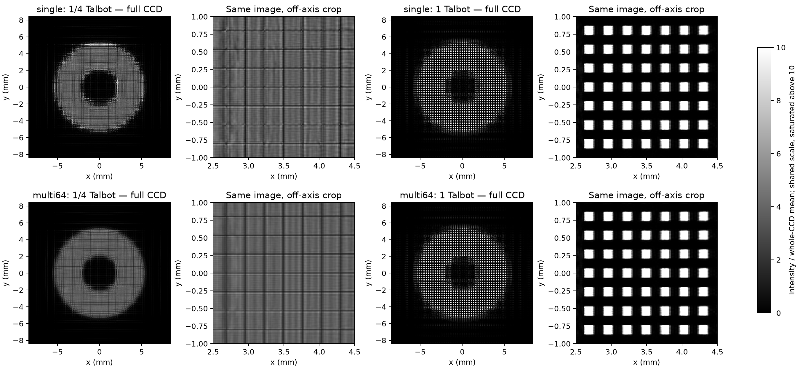
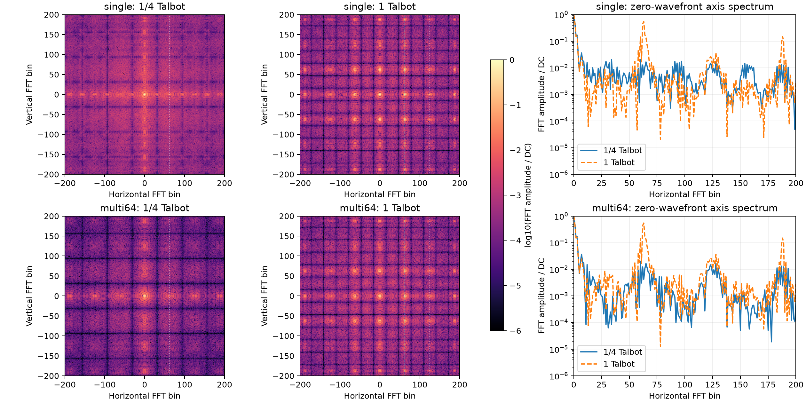
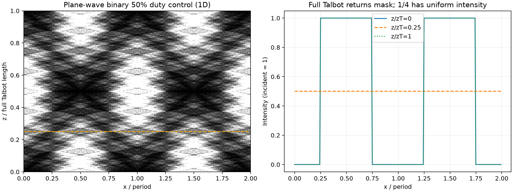
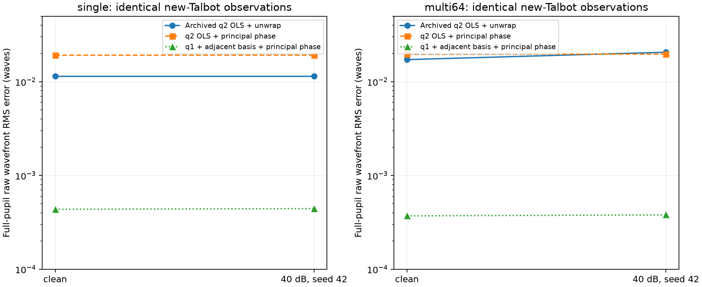
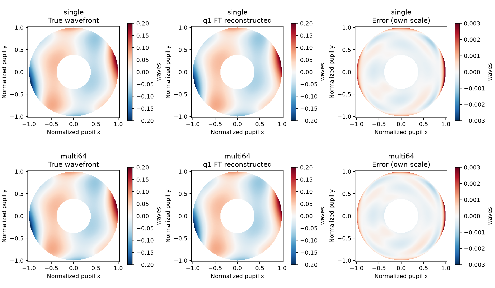
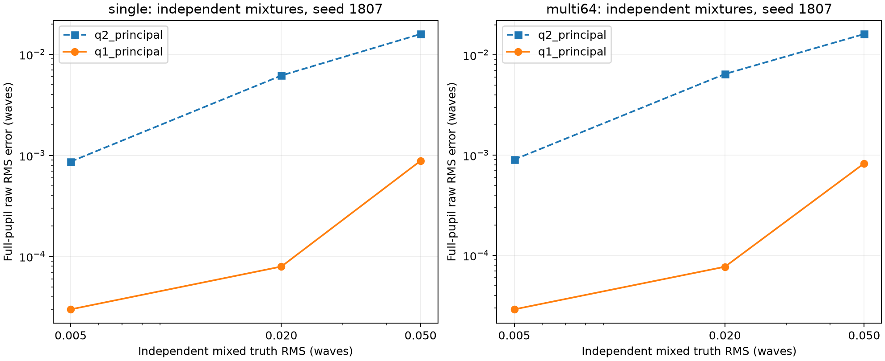

# 二维剪切干涉：泰伯条件对比与傅里叶反演异常排查

2026-11-10。本轮在 SJTU 实际执行完整网格传播、独立标定与验证。

**结论：一阶泰伯配置的 CCD 周期结构更清晰。先前 FT 误差升高，主要暴露了边带选择与相应差分模型、相位提取流程的问题，不能解释为一阶泰伯条件使系统变差。** 在同一份新配置观测上，改用基频边带、相邻级次差分基并独立标定，40 dB 全光瞳误差由单源 0.011409、64 源 0.020614，降至 **0.00044352、0.00038005 waves**。

这是小像差、模型匹配条件下的诊断结果。新方案仍有无噪声误差，尚不是经过实际 CCD 标定的仪器精度。

## 1. 项目现在走到哪里

研究主线是将完整三段衍射传播预测的原始相机强度直接用于 LM 拟合 Zernike 系数，并与 FFT 选窗、移频、相位展开、差分 Zernike 拟合比较。另两条工作线是 FT 频谱窗/有效区，以及 NA_in、NA_out 所控制的通光角范围。

| 时间 | 已有工作 | 与本次的关系 |
|---|---|---|
| 10 月下旬 | 核对 BUV0725 / Retrieval0806，接入完整衍射 LM，建立 uv workspace | 直接拟合与传统 FT 的代码基础 |
| 10 月 29—30 日，11 月 2 日汇总 | 原周期 1.34 µm：单源 FT、单源 LM、64 源 FT | **旧轮实际为三组；旧 64 源 LM 没有运行** |
| 11 月 4—5 日 | NA 扫描、周期匹配、相机视场与拟合点数对照 | 历史记忆已指出高 NA 的窗口、采样、视场及弱可辨识问题；本轮没有复核这批原始数据 |
| 11 月 9 日 | 明确 Square 是 25% 面积方孔阵列；合并 0.670 µm 新基准 | 第一完整泰伯长度按当前方孔实际周期计算 |
| 11 月 9 日新实验 | 单源/64 源 × FT/LM 四组，另有单源 OLS 对照 | 出现本次需要排查的 FT 退化 |
| 本轮 | 10 组正向模型、两种源数的 35 项标定、独立混合真值与噪声重复 | 给出异常的数值定位 |

已直接核对 [旧实验 Notion](https://app.notion.com/p/4148b24d37dc81909c08e08ce86ab6e6)、[新实验 Notion](https://app.notion.com/p/4148b24d37dc811f8362c5335b2edd85)，以及 Lody 会话 `d8d97a71-33ac-4c7d-aa3e-f594b8da5ac7`。历史报告中给出的 324 项审计是当时结果的数值核对，不能替代对边带模型适用性的检查。

## 2. 泰伯定义与控制变量

对当前未旋转 Square 方孔阵列，采用原位复振幅完整复现长度：

\[
z_T=\frac{2p^2}{\lambda},\qquad
z_{\rm eff}=\left(\frac1R+\frac1D\right)^{-1}.
\]

这里 R 是实际焦点到光栅的距离，D=53.6 mm。新配置物面 shift_z=−100 µm，经 0.2 倍横向倍率产生约 −4 µm 近轴焦移，故 R≈z_grating+4 µm。等式针对近轴二次相位模型；正向代码还包含既有源场角谱处理及有限窗口。

| 参数 | 历史旧轮 | 本轮严格 1/4 控制组 | 新一阶控制组 |
|---|---:|---:|---:|
| p / µm | 1.340 | 1.340 | 0.670 |
| 名义 z_grating / µm | 134 | 130.335839599 | 130.335839599 |
| 源场误差模式 / shift_z | OFF / 0 | ON / −100 µm | ON / −100 µm |
| R / µm | 134 | 134.335839599 | 134.335839599 |
| z_eff / µm | 133.665835411 | 134 | 134 |
| z_T / µm | 536 | 536 | 134 |
| z_eff / z_T | 0.249376559 | **0.25** | **1** |
| 相机 / 光栅网格 | 1200² / 2400² | 1680² / 3360² | 1680² / 3360² |

严格控制组之间只改变周期。相机、光栅窗口、采样、波长、占空比、NA、失调、真值、源的物理位置均一致。但周期同时决定泰伯比例、剪切量和载频，所以本实验不能把这些耦合量再分成完全独立的物理效应。

另外计算了原参数的 1200 网格复现、补到 1680 的旧参数组，以及固定 p=0.670 µm、移动光栅到 z_grating=29.520950594 µm 的 1/4 组。每组均有单源与 64 源，合计 10 组。固定周期的距离组给出相同定性趋势，但放大率和有限包络也随距离变化。

固定条件：λ=6.7 nm；NA_in/out=0.00769/0.02；面积透过率 25%；相机 dx=10 µm；光栅 dx=16.75 nm。单源对应原 (5,5)/新 (7,7)；64 源每轴 −11.725…+11.725 µm，padding 保持物理位置。真值保持原四项形状、全物镜光瞳 0.05 waves RMS。

## 3. CCD 上实际看到了什么

图中来自完整三段传播与方孔透射函数，包含多级衍射。每幅除以整张 CCD 的平均强度，所有面板共享 0…10 色标；超过 10 的值饱和显示。右侧是相同图像的离轴裁切，原始数组没有裁切。该归一化用于比较形态，原始总强度另保存在 metadata.json。

**1/4 组呈现更平滑的环形包络，周期结构弱；一阶组出现清晰的方孔周期结构。** 严格控制组零波前记录的总能量，新/旧分别为单源 0.99610、64 源 0.99564，说明可见差别主要来自空间调制的重分布。

下表取横向预期谐波位置附近 ±3 bin 的 7×7 区域内最大 FFT 幅值，除以 DC。它是频谱指标，**不是 Michelson 可见度，也不是强度功率百分比**。

| 光源 | 条件 | 基频峰 / DC | 二倍频峰 / DC |
|---|---|---:|---:|
| 单源 | 严格 1/4 | 0.020625 | 0.020503 |
| 单源 | 一阶 | **0.547091** | 0.036709 |
| 64 源 | 严格 1/4 | 0.001165 | 0.020142 |
| 64 源 | 一阶 | **0.546723** | 0.036322 |

新一阶组的强信号位于基频；它的幅值约为自身二倍频的 15 倍。源平均在两种周期下对频谱的影响不同，因此也不能直接将“单源/多源”的差异当作单一降噪效应。

### 一个可解释图像的理想控制

对一维 50% 占空比二值振幅掩膜 t，传播到 z_T/4 时：

\[
U=\frac{1-i}{2}t(x)+\frac{1+i}{2}t(x+p/2),\qquad t(x+p/2)=1-t(x),
\]

从而强度为常数 1/2；二维可分离方孔的对应值为 1/4。一阶则复现原方孔强度。这个控制解释了为何“分数泰伯”不自动等于高对比自像；有限光瞳、非均匀入射与像差会留下额外结构，所以不能用平面波图代替实际系统 CCD。

振幅/相位光栅的高对比平面不同，且有文献将半个完整复现长度称作第一 Fresnel/Talbot 平面；比较公式时必须核对约定。相关原始研究见 [Goldberg 等，2021](https://pmc.ncbi.nlm.nih.gov/articles/PMC7828504/)。本文始终使用 z_T=2p²/λ 的完整原位复现定义。

## 4. FT 反常结果来自哪里

### 4.1 125 bin 的位置验证正确，但它没有证明应提取这一边带

当前几何中相邻级次的载频为

\[
f_0=N\,dx_{cam}\frac{R}{p(R+D)}\quad\text{（FFT bin）}.
\]

新组 f0≈62.6866，正负一级差频 2f0≈125.373。原程序为保持 ±shear 的差分基，自动选择 125 bin。原位置验证说明正负一级的交叉项确实在那里，**却没有证明这个位置是完整干涉图最合适的波前测量边带**。实际高对比基频在约 63 bin。

代码证据：`evidence/new-code/talbot_ft.py:21` 直接将 nominal 设为 2×fundamental；`lsi/fourier.py` 使用两个反向位移的光瞳交集与对称差分基。

完整强度边带包含所有满足级次差的交叉项。二倍频不仅有 (+1,−1)，还有 (+3,+1)、(−1,−3) 等。甚至在理想完整自像下，50% 一维开口掩膜的二次谐波为零：高对比方波并不意味着二倍频也强。

本轮沿同一有限 CZT 算子单独传播 x 向 ±1 级，y 方向保留完整光栅，再比较其二倍频复包络与全图包络。允许最佳单个复增益后，相对残差为：

| 光源 | 严格 1/4 | 一阶 |
|---|---:|---:|
| 单源 | 0.6362 | 0.4658 |
| 64 源 | 0.5480 | 0.4648 |

因此，两种配置都不能将此边带当作纯 ±1 双束干涉。**该残差在新配置反而较小，它本身不能作为“新配置退化”的单一证据。** 真正直接的诊断来自后面的边带/差分模型重建对照。

### 4.2 Lasso 的失效与相位展开需要分别理解

历史新轮单源 Lasso 误差 0.17704 waves，有效秩 30/35，标定训练回解最大系数误差约 12.02 waves。这是失效流程，不能拿来评价一阶配置的光学能力。

即使切换到参考复信号扣除和 OLS，二倍频仍存在相位展开问题。现实现先将掩膜外相位置零，再整图展开和平滑。弱边带局部的 2π 分支变化、以及掩膜外展开值经过平滑进入边界，会破坏正负标定响应的对称性。

定义特征非对称比为 ||(f+ + f−)/2 − f0|| / ||(f+ − f−)/2||。在第 12 项 ±0.02 waves 系数标定中：

| 相位处理 | 单源 | 64 源 |
|---|---:|---:|
| 原展开、平滑 | 0.5506 | 0.5709 |
| 展开后重新将掩膜外归零、再平滑 | 0.2757 | 0.2876 |
| 同图、同窗、保留参考相位差主值 | **0.04710** | **0.04327** |

这定位了软件处理的贡献。但只改善这一指标并不保证最终重建更好，下一表就有反例。

### 4.3 在同一观测上重新标定，反常现象消失

两种新诊断方案均使用独立零像差参考、OLS、全部 35 个非 piston 模式的 ±0.02 waves 标定，共每种源数 71 张标定图。q2 方案保留原二倍频窗、掩膜与差分基，只改用主值相位；q1 方案改用约 63 bin 基频，并采用 Z(x−s)−Z(x) 的相邻级次差分与相应光瞳交集。q1、q2 半窗均为 25 bin，其余窗平滑和相位平滑相同。

**q1 同时改变边带及对应差分模型/有效区，并不是“只把 125 改成 63”。** 每个方案独立标定；评价始终覆盖完整 52,428 点物镜环形光瞳，包含外圈、倾斜、离焦和均值。训练使用 35 项全部自由，当前四项真值未参与响应矩阵计算。

| 同一新配置观测 | 单源 clean | 单源 40 dB | 64 源 clean | 64 源 40 dB |
|---|---:|---:|---:|---:|
| 既有 q2 OLS + 相位展开 | 0.01140357 | 0.01140899 | 0.01718601 | 0.02061424 |
| 本轮 q2 OLS + 主值相位 | 0.01913948 | 0.01919477 | 0.01958542 | 0.01968958 |
| **本轮 q1 + 相邻差分基 + 主值相位** | **0.00043612** | **0.00044352** | **0.00037089** | **0.00038005** |
| 既有同观测完整模型 LM | 约 1.1×10⁻¹⁶ | 0.00037223 | 约 7.2×10⁻¹⁷ | 0.00037169 |

单位均为 waves 的全光瞳 raw RMS。LM 行引用已经归档的同观测结果，本轮没有重跑 LM。

与既有新配置 OLS 相比，q1 在 40 dB 下分别改善约 **25.7 倍、54.2 倍**。在共同主值相位处理中，q1 相对 q2 又分别改善约 43.3 倍、51.8 倍。这支持“新配置的强基频与适配的差分模型更合适”的诊断。不能据此断言 FT 已普遍优于 LM。

| 本轮标定 | 秩 | 条件数 | 训练回解最大系数误差 / waves |
|---|---:|---:|---:|
| 单源 q2 主值 | 35/35 | 9.372 | 0.0014864 |
| 单源 q1 主值 | 35/35 | 14.597 | 0.00018444 |
| 64 源 q2 主值 | 35/35 | 9.292 | 0.0012304 |
| 64 源 q1 主值 | 35/35 | 14.615 | 0.00018658 |

条件数更低的 q2 仍更不准确，说明局部线性标定模型的偏差不能只用矩阵秩或条件数判断。

## 5. 验证结果与结论边界

基频主真值的相位差最大仅约 0.745 rad；直接检查显示该例中标准 unwrap 与主值相位全图一致。全部 70 个正负标定图中，基频有效区均没有 |相位差|>2.8 rad 的像素。因此，主值相位在这组小像差问题中有依据；大像差仍需可靠的带掩膜展开流程。

另用 seed=1807 生成三组独立 35 项混合真值，按不同 RMS 缩放；这些混合真值没有进入标定。

| 真值 RMS | 单源 q2 误差 | 单源 q1 误差 | 64 源 q2 误差 | 64 源 q1 误差 |
|---|---:|---:|---:|---:|
| 0.005 | 0.00086841 | **0.00002999** | 0.00090418 | **0.00002895** |
| 0.020 | 0.00617389 | **0.00007949** | 0.00645256 | **0.00007703** |
| 0.050 | 0.01588754 | **0.00088454** | 0.01616196 | **0.00082812** |

这里每个幅度只有一个独立混合样本，不构成完整动态范围测试。

对主真值的 40 dB 高斯噪声重复，seed=41…45，q1 误差均值±样本 SD 为单源 **0.00043651±0.00000747**，64 源 **0.00037223±0.00000827** waves。SD 描述噪声种子间波动，不是置信区间，也不包含物理参数不确定性。

本轮完整传播复现既有新观测，零波前/真值归一化图像的相对 L2 差异小于 10⁻¹²；本地系数复算、完整评价光瞳、piston、泰伯比例等 **173 项核验通过**。高阶环形基在不同 BLAS 构建间存在约 10⁻¹¹ 级数值差异，审计采用 rtol=10⁻⁹、atol=10⁻¹² waves 的指标容差。

尚不能外推的范围：真实 CCD 的像素积分、MTF、读出/散粒噪声、光栅制造误差、光谱宽度及标定误差未纳入此次比较；没有重做高 NA 扫描；没有完成旧参数与新参数所有反演链的全因子实验。主值 FT 的 clean 误差约 4×10⁻⁴ waves，仍体现有限窗、多波叠加、平滑及线性标定的剩余偏差。

## 6. 接下来应采用什么基准

保留当前一阶泰伯物理基准。FT 的下一版基准应以基频、对应差分几何和独立响应标定为起点，并把主值相位处理明确限定在小相位差条件。大像差时验证带掩膜展开、边界平滑和展开分支的一致性。将旧 Lasso 结果保留为失败记录，避免与合格流程混成光学精度比较。

之后再恢复 NA、频谱窗和有效区研究，每个物理配置先检查：完整 CCD 频谱、边带复振幅是否足够、标定训练回解、独立混合真值。高 NA 仍需先满足窗口与采样条件。

## 7. 文件与复现

本地目录：本报告所在 `talbot-investigation/`。远端目录：`/data/yk/shear-reference-lm/talbot-investigation-20261110`。既有实验目录保持为 `talbot-rerun-20261109`。使用私人 Conda、CPU、单个数值进程、4 个 BLAS 线程。

| 文件 | 内容 |
|---|---|
| code/forward_compare.py | 10 组完整网格正向图像 |
| code/phase_probe.py | 第 7、12 项的展开/掩膜诊断；正式执行 PROBE_ONLY=1 |
| code/calibrate_ablation.py | q1/q2 的完整 35 项独立标定 |
| code/validate_ablation.py | 独立混合波前、5 个噪声种子、观测复现 |
| code/order_mixing.py | ±1 隔离级次与完整边带对照 |
| code/audit_saved.py | 本地独立系数/指标复算 |
| results/ablation_metrics.csv | 本轮主要 FT 数值 |
| results/validation.json | 所有独立验证及完整系数 |
| results/order_mixing.json | 二倍频级次混合指标 |
| results/audit.json | 173 项核验明细 |
| results/*/metadata.json | 完整参数、源位置、归一化和原始强度指标 |
| figures/*.png、*.pdf | 可查看与单独导出的科学图件 |
| evidence/new-code/ | 只读归档的既有计算代码，包含 lsi 数值算子 |

在远端使用 `/data/yk/conda/envs/shear-reference-lm-py312/bin/python`，按 forward_compare、PROBE_ONLY phase_probe、calibrate_ablation、validate_ablation、order_mixing 的顺序运行。脚本按结果文件检查点续算；重做实验时复制到新的目录。既有模型由脚本中的 BASE 显式引用。记录的包版本见 `evidence/environment.json`。

### 检索来源轨迹

使用 Nowledge MCP，检索作用域由服务返回为 strict/default，未附加标签、来源或日期过滤。首次 query=`二维剪切干涉 四工况 泰伯 傅里叶 1/4`，mode=deep；主要使用 rank 1 `7b20f7c2-8437-4430-a816-44ab02d9696d`「两轮实验已补录 Notion」（score 0.99），rank 2 `328f2fc2-e13c-48c2-91fe-0ad015c59c23`「项目主线与三个研究目标」（score 0.94047）。前者读取全文，并用 Notion 原文、Lody 历史与服务器文件交叉核对。

补充 query=`二维剪切干涉 NA_out 36组 实验 2026-11-04`，mode=normal，limit=4。返回顺序：rank 1 主线记忆 `328f2fc2…`（0.99），rank 2 两轮实验 `7b20f7c2…`（0.99），rank 3 `crystal_83233410b56b`「NA_out 扫描实验」（0.89438），rank 4 `956a0b48-7fc1-461a-96f2-33d74ad47794`（无标题，0.83299）。第 3 条读取全文，仅用于历史背景。

图谱可视化工具未提供，且无法确认浏览器图谱与 strict/default 检索具有相同身份和空间限制，因此没有生成图谱；这不影响已读证据。Lody 的 session_list、session_history 均先读取各自完整 help，再执行有界检索。Notion 页标为 unverified，数值结论以原始数组和本轮实际计算为依据。

## 代码版本与留存（运行后补存）

实验编号 talbot-investigation-20261110；计算运行编号 run-01-retrospective。本轮未在开跑前完成Git固定版本，现依据实际文件SHA256补存；不追溯声称满足运行前要求。五份执行脚本哈希一致，lsi十二文件与基础提交完全一致。

- 计算快照：ch1y1z1/chessboard-lsi，完整提交 bccde9f8dad053f63491a7b1439fa4906b6206be；tag `exp/talbot-investigation-20261110/run-01-retrospective`。
- 参考物理基准：ch1y1z1/shear-reference-lm，完整提交 71ab81b18c9f017c6ddd3dfc302d18b0a2ba2542；同名运行tag。
- 后处理代码、图件及报告：当前后处理提交；tag `exp/talbot-investigation-20261110/postprocess-01-retrospective`。该提交完整SHA由GitHub标签和随结果附存的version-manifest.json给出。
- 原lsi基础：6da7b93caf426f50f509edfe2dec474d1a5a483d；非本次新增代码的完整替代。

计算入口保留于 code/；实际参考配置 reference/config_file.json；十组配置及真值见 provenance/configurations.json。运行命令和私有Conda路径见README。
